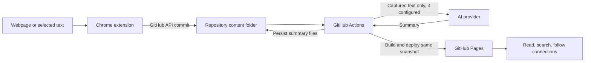

# Charta architecture and content format

Charta can run as a static GitHub Pages library, with a Chrome extension writing to its GitHub repository and GitHub Actions handling indexing and AI summaries. The public reader needs no application server. This is the target design; the [README](../README.md) describes the implemented draft and its remaining features. Canonical content and the static reader are now implemented, alongside a local editing server and an unpacked extension.

## System responsibilities

| Part | Responsibility | Credentials |
| --- | --- | --- |
| Static website | Browse folders and collections, search, display material and backlinks | None |
| Chrome extension | Capture pages and selections; create and edit collections; commit changes | Owner's repository token, kept in the extension |
| GitHub repository | Store canonical content and revision history | GitHub repository permissions |
| GitHub Actions | Validate records, optionally summarize, build catalog, publish | Job-scoped GitHub token; optional AI provider secret |

GitHub Pages serves static HTML, CSS, and JavaScript. It cannot host our write API or conceal a model API key. Project sites also live below a repository URL prefix, which affects routing and asset paths. [GitHub Pages overview](https://docs.github.com/en/pages/getting-started-with-github-pages/what-is-github-pages)



## Content layout

All saved user material, descriptions, summaries, collection membership, and folder metadata live in `content/`. Website code, extension code, and workflows live outside it.

```text
content/
  library.json
  collections/
    research/
      folder.json
      interfaces/
        collection.json
      history/
        folder.json
        early-web/
          collection.json
    references/
      folder.json
      typography/
        collection.json
  blocks/
    b_01/
      block.json
      body.md
      summary.json
      assets/
        image-<sha256>.webp
```

Folders are real directories containing `folder.json`; they may contain more folders and collections. Collection directories contain `collection.json`. A directory represents one folder or one collection. Collection-to-collection links are stored as references, independently of the directory tree.

Materials have one canonical home under `content/blocks/<id>/`. Their categorization lives in collection files inside the folder tree. This allows one image or article to appear in several collections without copying its file. A collection's path can change while its stable ID and incoming links stay intact.

`library.json` holds `schemaVersion` and the library title. Collections are optional: materials without a collection remain accessible in All materials, which is the default save destination. The legacy `inboxCollectionId` field is accepted when it references an existing collection; deleting that collection clears the field and preserves its materials. Folder records hold a stable ID, title, and optional sibling order. An unknown schema version must produce a useful error instead of a partial write.

### Material record

Example `content/blocks/b_01/block.json`:

```json
{
  "schemaVersion": 1,
  "id": "b_01",
  "type": "link",
  "title": "A reference about interface design",
  "category": "Design",
  "tags": ["interfaces", "software"],
  "source": {
    "url": "https://example.com/article",
    "title": "Original page title",
    "capturedAt": "2026-11-15T10:00:00Z"
  },
  "description": "My own note about why I saved this.",
  "bodyPath": "body.md",
  "assets": [],
  "related": [],
  "createdAt": "2026-11-15T10:00:00Z",
  "updatedAt": "2026-11-15T10:00:00Z"
}
```

Proposed types are `link`, `text`, `image`, and `file`. Audio and video links remain links in the first release. `body.md` contains saved plain text or Markdown, not executable webpage HTML. Files and thumbnails use local asset paths with MIME type, byte size, and an editable alt-text field in their asset records. Initially allow raster images, PDF, and plain text uploads. Validate file bytes as well as extensions; reject HTML, JavaScript, SVG, and other active formats because published assets can be opened directly on the library origin.

A saved link includes its URL and the content we actually capture. It does not promise a complete offline copy of the source website. Save an image or uploaded file into `assets/` before treating it as an archived asset. Remote image references must be labeled as references when downloading is unavailable.

Keep original source metadata, captured text, the owner's description, and AI output separate. The reader can then show what came from the source and what was added later.

### Collections and connections

Example `collection.json`:

```json
{
  "schemaVersion": 1,
  "id": "c_interfaces",
  "title": "Interfaces",
  "description": "References for calm, useful software.",
  "items": [
    { "kind": "block", "id": "b_01" },
    { "kind": "collection", "id": "c_typography" }
  ]
}
```

The `items` array defines manual order. Additional sort modes are views over that array. A block may appear in many collections; a collection can link to other collections. Optional `related` references on blocks represent explicit material-to-material links. Backlinks are derived by scanning these records, so users never maintain both directions.

Materials also have a readable `category` and a normalized `tags` array. Categories are broad subjects; tags support overlapping ideas independently of the filesystem. Legacy records default to `Uncategorized` and no tags. The Network view derives material-to-material edges from shared tags, categories, collections, and explicit `related` links, and retains the reason for every edge. This graph is computed from canonical content rather than stored as another source of truth.

The catalog resolves IDs to current paths. Reject duplicate IDs, missing targets, duplicate membership entries, and direct self-connections. Collection graphs may contain cycles; rendering must use visited IDs and load nested collections on navigation rather than recursively expanding them.

Removing a material from a collection removes its membership only. An unfiled material remains available in All materials. Deleting the canonical material is a separate operation and must resolve every incoming reference. Renaming folders or collections must preserve IDs.

## Website and minimal interface

Use HTML, CSS, and JavaScript modules for the reader, plus small Node scripts for validation and indexing. No server framework or runtime database is needed.

The build copies the website and canonical `content/` into a deployment directory and generates `content/_generated/catalog.json` there. The generated catalog contains path lookups, folder structure, memberships, backlinks, searchable text, and its source commit SHA. It is rebuildable and is not the source of truth. Larger libraries can split search text into separate lazy-loaded files.

Use hash routes such as `#/collections` for the root folder browser, `#/folder/f_research` for one physical folder, `#/collection/c_interfaces` for a folder's materials, and `#/block/b_01` for a material so bookmarked views reload on GitHub Pages without server routing. The browser shows direct children at each level, with breadcrumbs for the full physical ancestry. Canonical folder and collection records retain their existing IDs and paths; displaying a collection as a material folder does not copy or migrate it. Empty branches are hidden by default, while external channel references are shown as links. Folder material counts deduplicate shared materials and terminate on collection cycles. Resolve assets relative to the project base, not `/`.

```text
+------------------+---------------------------------------------+
| Charta            | Search                                      |
| Home             | Research / Interfaces                       |
| All materials    | Collection description             Add      |
|                  |                                             |
| Research         | [material] [material] [linked collection]    |
|   Interfaces     | [material] [material] [material]             |
|   History        |                                             |
| References       | Click material → one detail panel           |
+------------------+---------------------------------------------+
```

Use a neutral background, legible type, thin borders, restrained spacing, and previews where useful. The detail panel contains original material, source, owner note, short summary, and connections. Search covers titles, descriptions, captured text, and collection names. A narrow screen turns the sidebar into a drawer. All essential actions must work with keyboard focus and labeled controls.

The public page stays usable without the extension. When the owner has it installed, Add, Edit, Move, and Connect can open extension-owned screens through a narrowly defined message bridge. Configure the extension ID in the library, declare permitted website matches in `externally_connectable`, and validate the sender's exact origin and library path prefix as well as the message. Each write requires a deliberate owner save action in the extension. The webpage never receives the repository token. Without the extension, owner actions can point to the corresponding GitHub file. [Chrome website messaging](https://developer.chrome.com/docs/extensions/reference/manifest/externally-connectable)

## Chrome capture and persistence

The popup shows a source preview, editable title and note, collection search, and Save. The owner can create a folder or collection from the destination picker. The first capture modes are the current page and selected text; local file upload and image capture follow in the same release.

Use Manifest V3 with `activeTab`, `scripting`, `storage`, `contextMenus`, and GitHub API host permission. User invocation grants temporary access to ordinary webpages; Chrome internal pages remain restricted. [Chrome activeTab](https://developer.chrome.com/docs/extensions/develop/concepts/activeTab)

Extract useful metadata and a bounded readable-text capture from the current page. Keep the URL and capture time. Cross-origin image downloading can require an additional optional host grant; offer a file upload or a clearly labeled source reference when unavailable. Network requests belong in the extension service worker or extension page. [Extension network requests](https://developer.chrome.com/docs/extensions/develop/concepts/network-requests)

Start with a fine-grained personal access token restricted to one repository and ordinary content write permission. This avoids a shared authentication service, at the cost of manual setup. GitHub permissions are repository-wide, not restricted to `content/`; extension code must allow writes only to validated content paths. Keep workflow-file permissions out of the token. [GitHub personal access tokens](https://docs.github.com/en/authentication/keeping-your-account-and-data-secure/managing-your-personal-access-tokens)

Keep that token in extension `storage.session`, which is memory-backed and inaccessible to content scripts by default. Restarting Chrome or reloading the extension requires reconnecting. Store repository settings and pending captures in extension-owned persistent storage, without tokens, restricted to trusted contexts. [Chrome storage](https://developer.chrome.com/docs/extensions/reference/api/storage)

A capture changes both a material and its destination collection, sometimes adding asset files. Use one Git tree, one child commit, and a non-forced branch ref update so those changes appear together. If the branch has moved, reload its head, merge memberships, and retry with a bounded backoff. Never overwrite another capture with a stale collection file. A one-file Contents API write remains useful for isolated edits. [Git trees](https://docs.github.com/en/rest/git/trees), [Git references](https://docs.github.com/en/rest/git/refs), [Contents API](https://docs.github.com/en/rest/repos/contents)

Use stable operation IDs for retryable saves. Search existing normalized source URLs before creating a new link block; offer to connect the existing material. Normalize conservatively: remove known tracking parameters, preserve meaningful query parameters, and do not equate different text selections just because their source page matches.

Show three distinct outcomes: queued locally, saved to GitHub with a commit, and published. Keep an interrupted save in the extension queue across popup closure and worker restarts. The extension reads collection files from the latest repository head rather than relying on the potentially older Pages catalog. Confirm publication from revision inclusion or Git ancestry plus the expected material and membership in the published catalog; exact commit equality is insufficient when enrichment adds a child commit.

## AI summaries and suggestions

When configured, Actions generates a short summary from the captured text. A link without useful text gets a metadata-only status rather than an invented article summary. AI is an enrichment step: saving and publishing still work when the provider is unavailable or no key is configured.

Store output as `summary.json` beside the material, with `status`, `text`, `inputHash`, provider/model identifiers, generation time, and whether the owner has edited it. Human-edited summaries must not be replaced automatically. Hash the actual inputs so unchanged material does not incur another model call. A collection summary can use its description and member summaries, with its own input hash and sidecar file.

AI-suggested connections stay separate from accepted connections until the owner adds them. Keep this as a small suggestion list in the material panel. Ordinary collection membership and explicit links work without AI.

Use an Actions secret for the model key, with a provider adapter rather than a hardcoded account. Only the enrichment job receives it. Pass captured text as data to a fixed, tool-free summarization request; validate its output and never interpolate captured text into shell commands. Use a bounded input size and per-run item budget. Configuring AI means sending the captured text to the selected provider. [Actions secrets](https://docs.github.com/en/actions/how-tos/write-workflows/choose-what-workflows-do/use-secrets), [Actions secure use](https://docs.github.com/en/actions/reference/security/secure-use)

## Publishing workflow

Use one coordinated workflow for trusted default-branch changes to content or application code, plus manual dispatch:

1. Read the latest branch head and validate all canonical records and references.
2. Enrich pending or changed material when AI is configured; record partial failures and continue.
3. Persist generated summaries under `content/` with conflict checks against the input hash and current branch head.
4. Build the catalog and website from the exact resulting snapshot, including saved summaries. Record that checkout's commit SHA, which may differ from the original workflow event's `github.sha` after summary persistence.
5. Upload and deploy the Pages artifact; keep the source commit SHA available for the extension's publish status.

Serialize enrichment writes, scan all still-pending items on each run, and prevent an older deployment from superseding a newer one. Re-read records before committing output if another capture arrives during generation. A protected branch that forbids direct updates needs a later PR-based mode; the initial template assumes the owner can commit content directly.

Commits made with `GITHUB_TOKEN` do not trigger another push workflow. The same workflow must therefore continue through build and deployment after committing summaries. [Workflow trigger behavior](https://docs.github.com/en/actions/how-tos/write-workflows/choose-when-workflows-run/trigger-a-workflow)

Give only the enrichment writer `contents: write`. The Pages deploy job needs `pages: write` and `id-token: write`, using the `github-pages` environment. Pull-request checks validate without receiving provider secrets or publishing. [Custom Pages workflows](https://docs.github.com/en/pages/getting-started-with-github-pages/using-custom-workflows-with-github-pages)

## Hosting boundaries

The first release is a public personal archive. Ordinary Pages publication remains public even with a private source repository; true private collections need a different access-controlled deployment. [Pages visibility](https://docs.github.com/en/pages/getting-started-with-github-pages/creating-a-github-pages-site)

Keep files small and use local thumbnails. Pages has a 1 GB published-site limit and a soft 100 GB monthly bandwidth limit. Git blocks normal files above 100 MiB, and Git LFS is not supported with Pages. Set a smaller application upload cap when the capture implementation is tested; large video files should remain source links. [Pages limits](https://docs.github.com/en/pages/getting-started-with-github-pages/github-pages-limits), [GitHub large files](https://docs.github.com/en/repositories/working-with-files/managing-large-files/about-large-files-on-github), [Git LFS limitations](https://docs.github.com/en/repositories/working-with-files/managing-large-files/about-git-large-file-storage)

Publishing and AI are asynchronous. Dynamic pages, restricted pages, and inaccessible media may provide only partial capture. Render saved text safely, allow only safe link schemes, and never execute uploaded HTML or scripts inside the library origin.

Research checked on 15 November 2026. Model-provider choice, public extension distribution, and a smoother authentication flow remain implementation decisions. None requires changing the content model.
